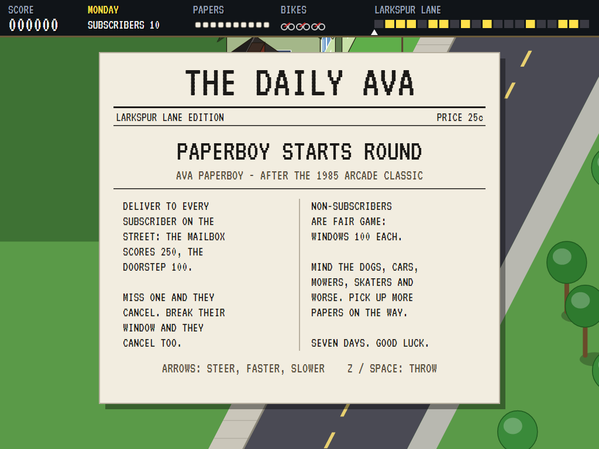
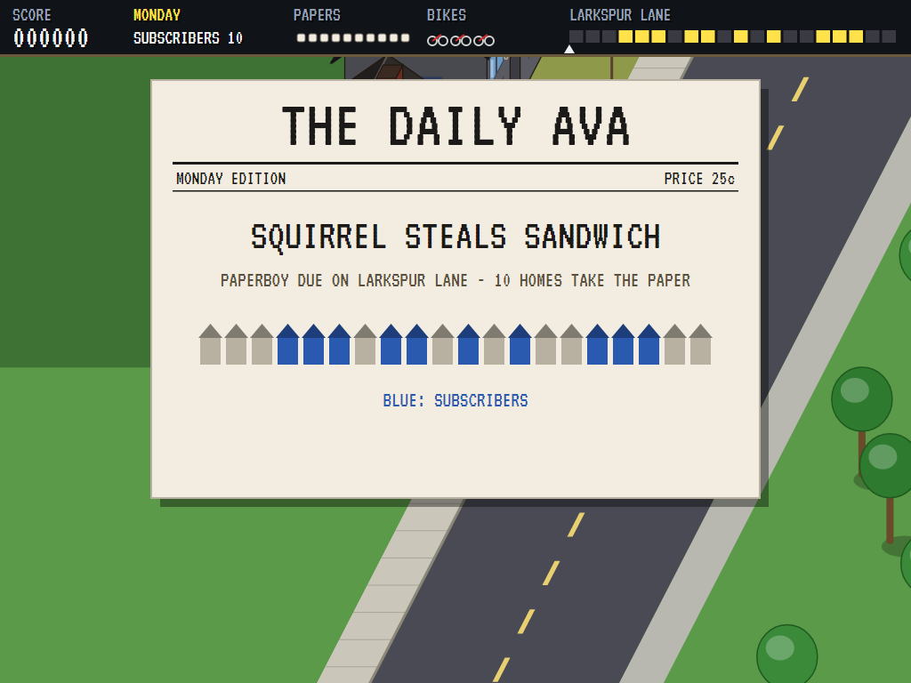
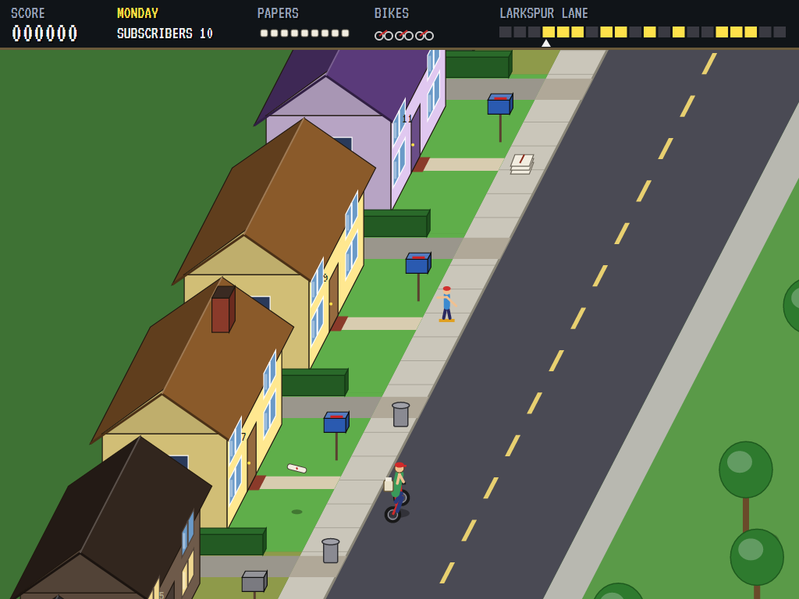
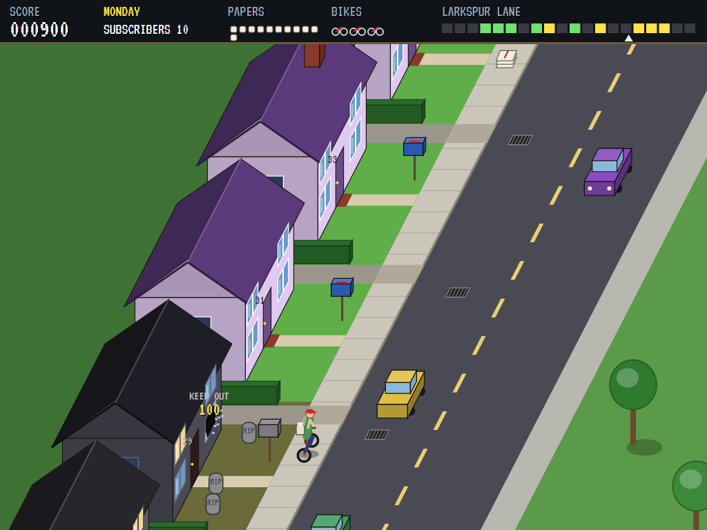
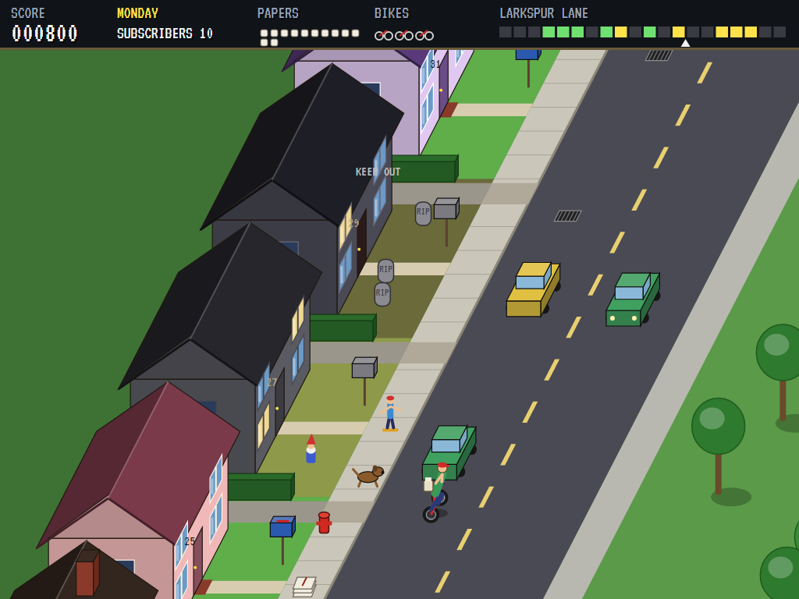
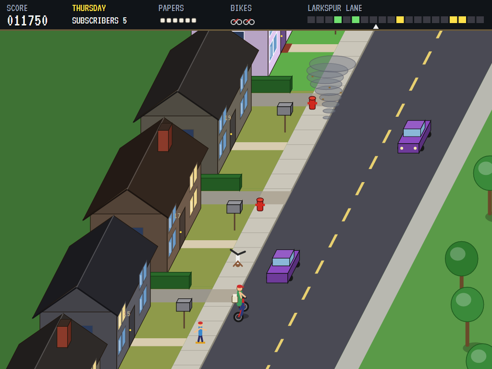
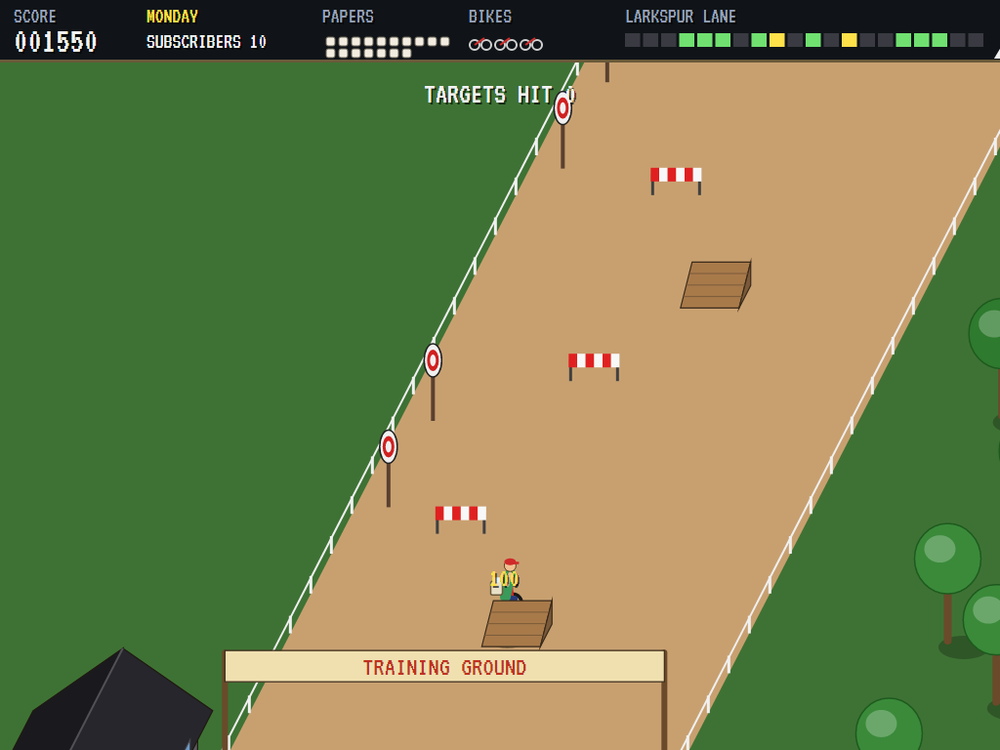
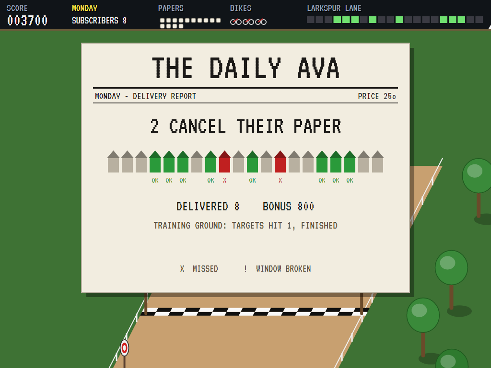
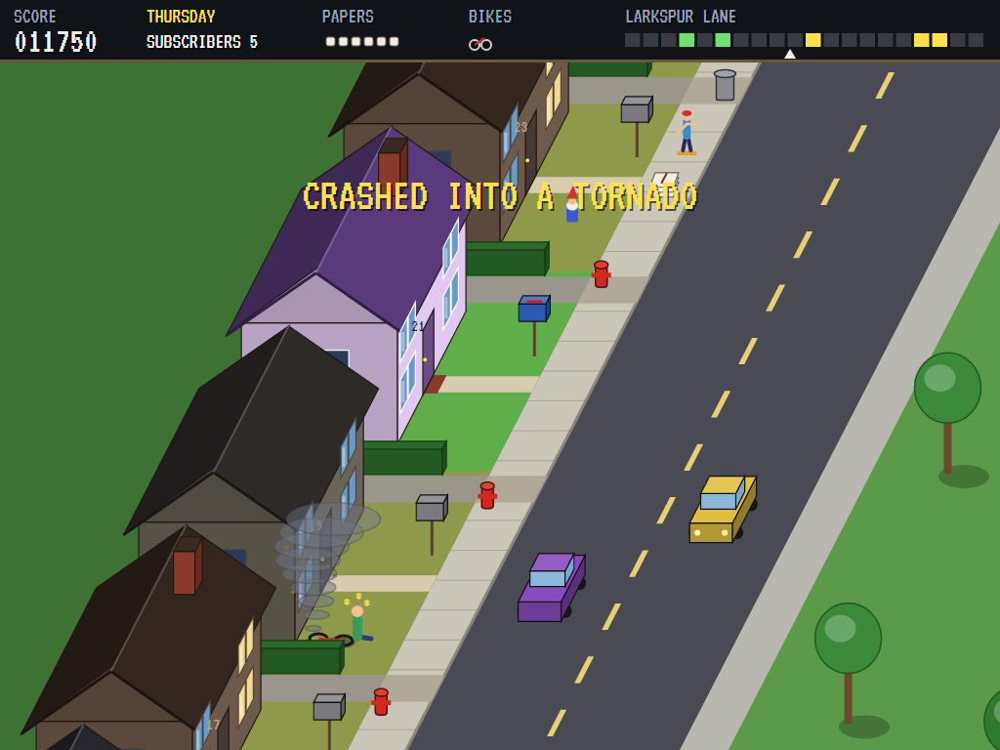
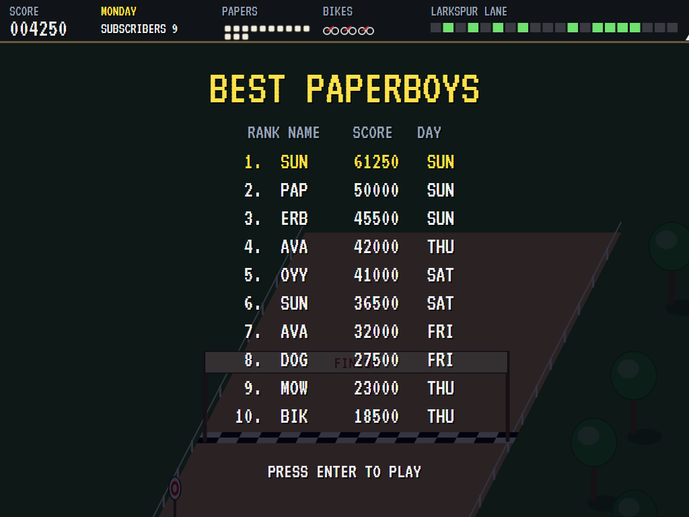

# AVA Paperboy

[](https://github.com/Harlock123/AVAPaperboy/actions/workflows/build.yml)

A paper-round game in the style of Atari's 1985 arcade game **Paperboy**, built with .NET 10 and
Avalonia UI. Ride your bike up Larkspur Lane for a week, Monday to Sunday, and throw a paper to every
house that takes one. Miss a subscriber, or break their window, and they cancel. The houses that
don't take the paper are fair game. Dogs, cars, lawnmowers, skateboarders and worse get in the way,
and at the end of every street there's the training ground.

## Features

- **Larkspur Lane**: twenty houses down one side of a street that runs diagonally up the screen, seen from above on the street side, so you face the house fronts and their roofs.
  - **Subscribers'** houses are brightly painted, with green lawns and blue mailboxes.
  - **Non-subscribers'** houses are drab, with parched lawns. One of them has a garden full of gravestones.
- **The paper round**:
  - Throw papers to the left as you ride. A paper in a subscriber's mailbox scores 250; one at the door, or on the path up to it, scores 100.
  - The mailbox flag goes up when a house has its paper.
  - At the end of the day, every subscriber you missed, or whose window you broke, cancels. Deliver to every subscriber and the bonus doubles, and a neighbour signs up.
  - Run out of subscribers and the game is over.
  - Non-subscribers' windows and mailboxes score points when you break them.
  - Your bag holds ten papers to start with. Bundles on the pavement top it up.
- **In the way**:
  - **Standing still:** hedges between the gardens (keep to the gap by the pavement), fire hydrants, dustbins, drains, roadworks, garden gnomes and gravestones.
  - **Moving:** cars in both directions, dogs that give chase, lawnmowers running on their own, skateboarders on the pavement, and breakdancers.
  - **From Thursday:** a tornado.
  - Most of them can be hit with a paper for points. A paper on the nose sends a dog home.
- **The training ground** at the end of every street: jump the ramps, dodge the barriers and hit the targets for points. Reaching the finish scores 1,000. A spill here ends the day but costs no bike.
- **Three bikes.** Ride all seven days of the week to be Paperboy of the Week, worth 5,000 points.
- **The Daily Ava**: each morning's front page, with its headline and a map of who takes the paper. Each evening the delivery report shows who got their paper and who cancelled.
- **Sound**: an original bouncy riding tune, and sounds for the throws, mailboxes, doors, breaking glass, the bike bell, crashes, barking, car horns, the tornado, ramps and targets. All mixed by OpenAL.
- **Attract mode**: leave the title alone for 15 seconds and a computer paperboy rides the round. It:
  - picks a line that misses everything coming, looking ahead to where each thing will be
  - throws for mailboxes and doors
  - breaks the odd non-subscriber's window when it has papers to spare
  - jumps the ramps and hits the targets
- **A top-ten high-score table** with arcade-style initials entry; it records the day reached.
- **Gamepads** through SDL2, as well as the keyboard.
- **Any window size**: the screen scales to fit, letterboxed. **Ctrl+S** saves a screenshot.
- **One self-contained executable** per platform: Windows, macOS and Linux on Intel/AMD and ARM.

## Screenshots

| The Daily Ava | Monday morning | On the round |
|:-------------:|:--------------:|:------------:|
|  |  |  |
| The rules, on the front page. | The headline, and who takes the paper. | A paper on its way to a subscriber. |

| Traffic | A dog | The tornado |
|:-------:|:-----:|:-----------:|
|  |  |  |
| A window broken at the haunted house, cars both ways. | A dog gives chase; a skateboarder heads this way. | Thursday: a tornado on the road. |

| The training ground | The delivery report | A spill |
|:-------------------:|:-------------------:|:-------:|
|  |  |  |
| Over a ramp, with the targets ahead. | Two subscribers cancel. | Seeing stars. |

| The best paperboys | | |
|:------------------:|:-:|:-:|
|  | | |
| The high-score table. | | |

The screenshots are made by the tests, which play the game in a real (headless) window; see
[Tests](#tests).

## Download and run

Ready-to-run builds for Windows, macOS and Linux, on both Intel/AMD and ARM, are on the
[Releases page](https://github.com/Harlock123/AVAPaperboy/releases/tag/latest). **Latest build** is
rebuilt on every push to `main`. Each download is one self-contained executable: no .NET install is
needed.

| Platform | Archive |
|---|---|
| Windows | `AVAPaperboy-win-x64.zip`, `AVAPaperboy-win-x86.zip`, `AVAPaperboy-win-arm64.zip` |
| macOS | `AVAPaperboy-osx-arm64.tar.gz` (Apple silicon), `AVAPaperboy-osx-x64.tar.gz` (Intel) |
| Linux | `AVAPaperboy-linux-x64.tar.gz`, `AVAPaperboy-linux-arm64.tar.gz`, `AVAPaperboy-linux-arm.tar.gz` |

```bash
tar -xzf AVAPaperboy-linux-x64.tar.gz     # or linux-arm64, linux-arm, osx-arm64, osx-x64
./AVAPaperboy
```

On Windows, unzip and run `AVAPaperboy.exe`. On macOS, if Gatekeeper refuses to open it, run
`xattr -d com.apple.quarantine AVAPaperboy` once. Run with `--no-audio` for silence.

**Sound** comes through OpenAL Soft, built in for every platform. In a virtual machine the game
detects it and uses a larger audio buffer, so the sound doesn't break up.

**Gamepads** use SDL2, which is bundled for Windows, macOS and Intel/AMD Linux. ARM Linux builds need it
installed; without it the keyboard still works:

```bash
sudo apt install libsdl2-dev            # Debian / Ubuntu / Raspberry Pi OS
sudo pacman -S --needed sdl2-compat     # Arch / Omarchy
```

## Controls

| Input | Action |
|-------|--------|
| **Enter** / **Space** | Start; skip the front page or the report |
| **Left** / **Right** (or **A** / **D**) | Steer across the street |
| **Up** / **W** (hold) | Faster |
| **Down** / **S** (hold) | Slower |
| **Z** / **X** / **Space** / **Ctrl** | Throw a paper (to the left) |
| **P** / **Esc** | Pause (Esc again to quit) |
| **M** | Mute |
| **Ctrl+S** / **Cmd+S** | Save a screenshot to the Pictures folder |

**Gamepad**: left stick or D-pad to ride, **A** or **B** to throw, **Start** to start and pause,
**Back** (while paused) to quit.

**Entering initials**: type letters, or dial with **Up**/**Down** and accept with **Space**; **Left** /
**Backspace** go back; **Enter** finishes.

## Scoring

| What | Points |
|---|---:|
| A subscriber's mailbox | 250 |
| A subscriber's door or path | 100 |
| A non-subscriber's window, mailbox | 100 each |
| A dog, a skateboarder, a breakdancer, a lawnmower | 200, 250, 150, 100 |
| A gnome, a gravestone, a dustbin, a car | 100, 100, 50, 50 |
| A ramp jumped, a target hit | 100, 250 |
| The training ground's finish | 1,000 |
| Each subscriber delivered | 100 at the end of the day, doubled if all of them were |
| The whole week | 5,000 |

## Tests

```bash
dotnet test AVAPaperboy.slnx
```

The engine has no UI and runs in fixed 60 Hz steps, so it plays the same at any frame rate, and a seed
always plays the same game. The tests check:

- **The street:** ten of the twenty houses subscribing, one haunted house, more in the way as the week goes on, and the tornado only later in the week.
- **Riding:**
  - the front page first, then the speeds and the steering
  - hedges and the gap by the pavement, things and cars that crash the bike
  - the last bike ending the game, and bundles topping up the bag
- **Papers:**
  - throwing (one per press), mailboxes and doors scoring
  - a subscriber's broken window making them cancel
  - non-subscribers' windows and mailboxes scoring
  - dogs (and outrunning them), and the tornado taking papers
- **The end of the day:** cancellations, a perfect day's new subscriber, everyone cancelling, and finishing the week.
- **The training ground:** ramps, the finish, targets, and a spill that costs no bike.
- **The machine:** the computer paperboy getting through Monday, the attract mode, initials, the same game from the same seed, and the high-score file.

The screenshot tests draw the real screen in a headless window. To refresh the README's pictures:

```bash
PAPERBOY_SHOTS=$PWD/Images dotnet test tests/AVAPaperboy.Tests --filter ScreenshotTests
```

To see how the computer paperboy gets on over a week (for tuning):

```bash
PAPERBOY_PROBE=1 dotnet test tests/AVAPaperboy.Tests --filter PaperboyProbe --logger "console;verbosity=detailed"
```

## Building

```bash
dotnet build AVAPaperboy.slnx
dotnet run --project src/AVAPaperboy
```

Needs the .NET 10 SDK. The sounds are made by `tools/make_sounds.py` (standard-library Python):
`python3 tools/make_sounds.py` rewrites `src/AVAPaperboy/Sounds`.

## Project structure

```
AVAPaperboy/
├── AVAPaperboy.slnx
├── src/AVAPaperboy/
│   ├── Engine/
│   │   ├── GameEngine.cs        # States, the title and demo cycle, and the music
│   │   ├── GameEngine.Play.cs   # The bike, papers in flight, deliveries and damage, the
│   │   │                        # neighbourhood's hazards, crashes, and the end of the day
│   │   ├── Street.cs            # Larkspur Lane: the houses, what's in the way each day, the
│   │   │                        # training ground, and the headlines
│   │   ├── RiderPilot.cs        # The computer paperboy, for the demonstration (and the tests)
│   │   ├── Entities.cs, Geometry.cs
│   │   ├── HighScoreTable.cs, InitialsEntry.cs
│   │   ├── InputHandler.cs, ControllerManager.cs  # Keys and an SDL2 gamepad
│   │   └── SoundManager.cs      # Effects, the riding music and the tunes through OpenAL
│   ├── Audio/                   # The OpenAL engine (from the author's AVABand)
│   ├── Views/                   # The street in projection, the houses, the hazards, the
│   │                            # paperboy, and The Daily Ava's pages
│   └── Sounds/                  # The synthesised effects and tunes
├── tests/AVAPaperboy.Tests/     # Gameplay, screenshot and probe tests
├── tools/make_sounds.py
└── Images/                      # Screenshots
```

## About and licence

AVA Paperboy © 2026 Lonnie Watson, under the [MIT License](LICENSE).

*Paperboy* © 1985 Atari Games; the name belongs to its current owner. AVA Paperboy is an
independent, unofficial game in its style. Its street, houses, hazards, newspaper, graphics, sounds,
tunes and code are its own; nothing is taken from the arcade machine's program, graphics, sound or
music. It is not affiliated with or endorsed by any rights holder.
